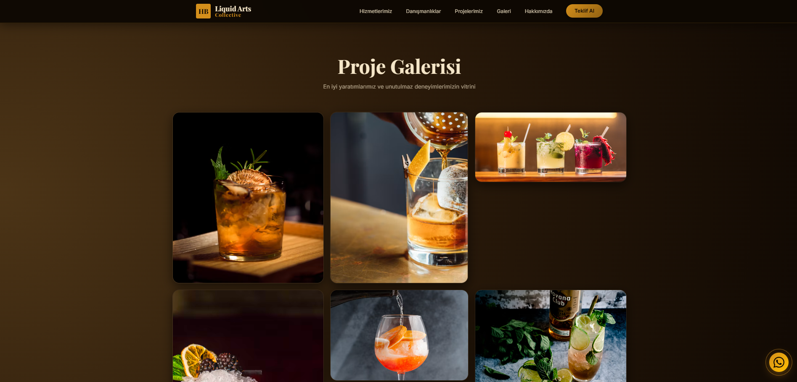
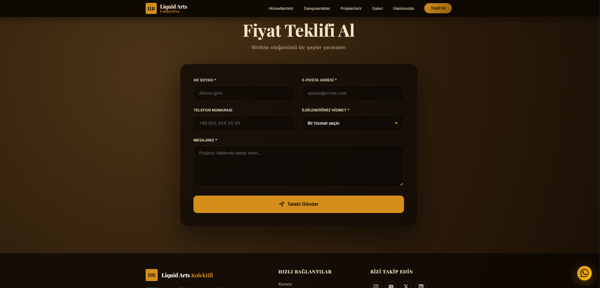
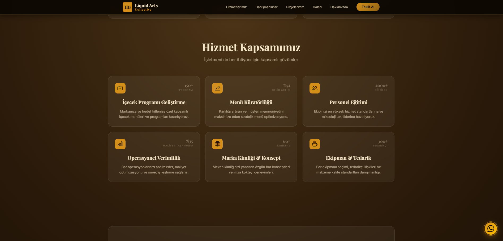

# 🍸 HB Liquid Arts Collective – Miksoloji Danışmanlık Web Sitesi

Butik içecek danışmanlığı ve miksoloji akademisi için geliştirilmiş, çok sayfalı kurumsal web sitesi. Oteller, restoranlar ve premium mekanlara sunulan danışmanlık, workshop ve catering hizmetlerini tanıtır; ziyaretçilerden teklif talebi toplar.

> **Tasarımdan koda:** Arayüz önce **Figma**'da tasarlandı, ardından **Antigravity** ile yapay zeka destekli olarak koda döküldü.

## 📸 Ekran Görüntüleri

| Proje Galerisi | Fiyat Teklifi Formu |
|---|---|
|  |  |



## ✨ Sayfalar ve Özellikler

| Sayfa | İçerik |
|---|---|
| **Ana Sayfa** | Hero alanı, yaklaşan etkinlikler (workshop / tadım) karuseli, hizmet özeti ve teklif formu |
| **Hizmetlerimiz** | Danışmanlık, workshop ve catering hizmetleri ile hizmet kapsamı kartları |
| **Danışmanlıklar** | Otel ve restoranlara yönelik içecek programı, menü küratörlüğü ve bar tasarımı danışmanlığı |
| **Projelerimiz** | Tamamlanan projeler |
| **Galeri** | Masonry düzeninde kokteyl ve etkinlik galerisi |
| **Hakkımızda** | Firma tanıtımı |

- Tüm sayfalarda yeniden kullanılan **iletişim / teklif formu** bileşeni (`_ContactForm.cshtml`)
- Sabit **WhatsApp** iletişim butonu
- Sayfa bazında ayrılmış **SCSS** dosyaları ve koyu, sıcak tonlu premium arayüz

## 🛠️ Teknolojiler

- **Backend:** ASP.NET Core Razor Pages (.NET 9), C#
- **Frontend:** Razor, SCSS (Web Compiler ile derleme), JavaScript
- **Tasarım:** Figma
- **Geliştirme:** Antigravity (yapay zeka destekli geliştirme)

## 🏗️ Proje Yapısı

```
HBLiquidArtsCollective/
├── Pages/
│   ├── Index, Hizmetlerimiz, Danismanliklar, Projelerimiz, Galeri, Hakkimizda
│   └── Shared/           # _Layout ve ortak _ContactForm bileşeni
└── wwwroot/
    ├── scss/ ve css/     # Sayfa bazlı stil dosyaları
    └── js/
```

## 🚀 Kurulum

**Gereksinimler:** .NET 9 SDK

```bash
git clone https://github.com/erdemgltekin/HBLiquidArtsCollective.git
cd HBLiquidArtsCollective
dotnet run
```

Uygulama veritabanı gerektirmez; çalıştırdıktan sonra terminalde görünen `localhost` adresinden açılır.

## 👤 Geliştirici

**Kadir Erdem Gültekin** – Junior Full-Stack Developer · AI-Native Geliştirme

- LinkedIn: [linkedin.com/in/kadir-erdem-gültekin-27a090282](https://www.linkedin.com/in/kadir-erdem-g%C3%BCltekin-27a090282/)
- Diğer projeler: [Wine & Spirits ERP & CRM](https://github.com/erdemgltekin/Wine_Spirits) · [cetinkayahealth.com](https://cetinkayahealth.com) · [aseitex.com](http://aseitex.com)
